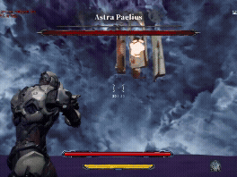

# TeamProject_RiftRunners

- Unreal Engine 5.8 기반의 TPS 로그라이크 팀 프로젝트입니다. PCG 기반 절차 생성과 소울라이크 보스 전투를 결합했으며, 멀티플레이를 지원합니다.
- 본 저장소의 코드는 팀원별 폴더로 정리되어 있으며, 제가 담당한 코드는 `Workspace/KHB`에 있습니다.

## 프로젝트 소개

- 장르: TPS · 로그라이크
- 주요 특징: PCG 기반 절차 생성 · 소울라이크 보스 전투 · 멀티플레이
- 개발 기간: 2026.08.04 ~ 2026.10.15
- 팀 구성: 4인 팀 프로젝트

## 영상 / 발표 자료

- [담당 기능 시연 영상 보기](https://youtu.be/_0JIreGtLfY)
- [전체 플레이 영상 보기](https://youtu.be/xMURd-Z_OUk)
- [포트폴리오 PPT 보기](https://canva.link/zqhkmoz121da7fo)

## 팀원 소개

- 최영우(팀장): PM · 초기 GAS 세팅 · Weapon · 무기 PCG
- 최우석: Player · Environment
- 김현빈: 몬스터 AI · 적 공용 전투 프레임워크 · 보스
- 김명석: Class · Skill · Map · UI

## 담당 역할

- **몬스터 AI:** 타깃 선정과 지상·공중 이동, 추적 슬롯 구현
- **적 공용 전투 프레임워크:** 데이터 기반 몬스터 구성과 StateTree·GAS 기반 전투 흐름 구현
- **보스:** 체력에 따른 페이즈 전환과 페이즈별 공격 패턴 구현

## 기술 스택

### 개발

- C++
- Unreal Engine 5.8
- Gameplay Ability System (GAS)

### 협업

- Git/GitHub
- Discord

## 참고

- 이 저장소는 코드와 프로젝트 문서 열람용이며, 게임 실행에 필요한 에셋과 의존 코드는 포함하지 않습니다. 따라서 **Unreal에서 실행하거나 패키징할 수 없습니다**.
- 실제 동작 화면과 설명은 **페이지 상단 포트폴리오**를 참고해 주세요.
